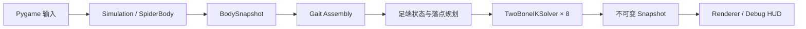
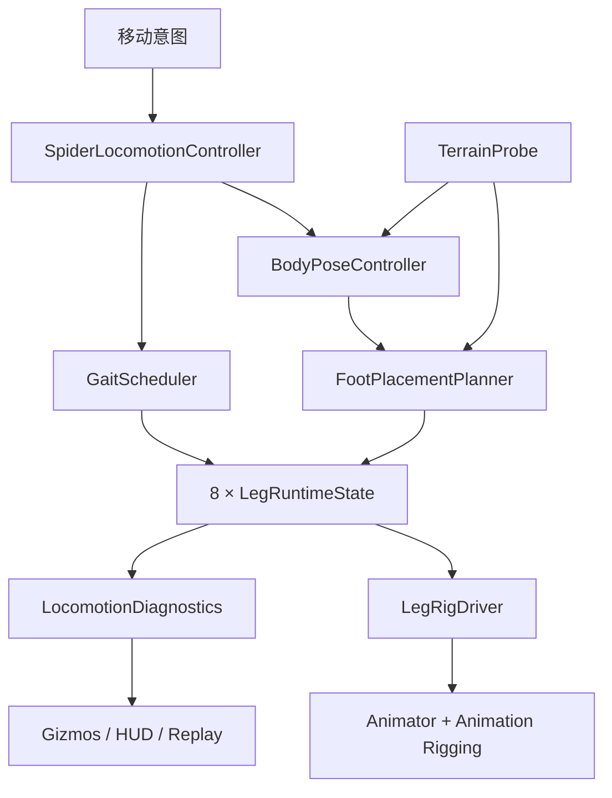

# Project9-Spider2D：二维到三维迁移设计

> 目标平台：Blender + Unity  
> 文档状态：设计基线，不包含实现代码  
> 分析基线：Project9-Spider2D v1.0.0（2026-07-29 工作区状态）

## 1. 结论先行

Project9-Spider2D 适合作为三维版本的**行为原型和不变量基线**，不适合作为可直接翻译的类结构。

推荐路线是：

1. 保留足端世界锁定、四阶段迈步状态机、触发阈值、两段长度约束、分组调度、候选落点的接受/延后/降级语义，以及固定子步和诊断快照。
2. 把二维几何全部提升为“身体局部坐标 + 地表局部坐标 + 三维世界坐标”，引入地面法线、身体高度、俯仰/横滚、真实抬脚轨迹和三维碰撞体积。
3. 在 Blender 中制作干净的 Generic deform rig；Blender 控制器和 IK 约束只用于美术验证，不把它们当成 Unity 运行时控制系统。
4. 在 Unity 中采用“纯数据运动核心 + 地形查询 + 步态调度 + Rig 驱动”的组合架构，避免照搬当前 Assembly 继承链。
5. 第一版先做**运动学、平地、无刚体动力学**的三维等价版本；平地验收通过后再加入不平地形和可选物理交互。

最重要的判断是：二维到三维并不只是把 `Vector2` 改为 `Vector3`。二维模型把弯曲平面、地面高度、身体姿态和碰撞关系都隐式固定了，而这些在三维中必须成为显式状态或约束。

## 2. 当前架构的事实核对

### 2.1 需要纠正的命名前提

当前代码并不存在名为 `Spider`、`Leg`、`GaitController` 的三个独立运行时类：

- “Spider”实际由 [`SpiderBody`](../src/spider_sim/spider.py) 表示，只管理身体位置、速度和单一 heading。
- “Leg”被拆成不可变的 [`LegMount`](../src/spider_sim/leg.py) 与 [`_LegRuntime`](../src/spider_sim/stepping.py)；没有公开的单腿领域对象。
- “GaitController”实际分散在 `SingleLegStepAssembly`、`FourPhaseGaitAssembly` 和 `ConstrainedGaitAssembly` 的继承链中。
- 只有 [`TwoBoneIKSolver`](../src/spider_sim/ik.py) 与概念命名基本一致。

因此，下文的映射以**职责**为单位，而不是按假设中的类名机械迁移。

### 2.2 已确认的数据流



关键边界如下：

| 当前模块 | 已实现职责 | 当前限制 |
|---|---|---|
| `Simulation` | 限制帧间隔、使用子步更新身体、提供快照 | 完整步态并不由它持有；demo 在外部单独更新 assembly |
| `SpiderBody` | 加速度受限的到达运动；按速度方向平滑 heading | 只有平移和绕平面法线的旋转；步态失败不会反向限制身体 |
| `LegMount` | 腿 ID、左右侧、排号、髋点、默认足点、弯曲提示 | 全是二维身体局部坐标；两侧和前后通道被硬编码为平面关系 |
| `_LegRuntime` | 足端世界位置、步态状态、阶段计时、目标、计数 | `foot_height` 与 IK 无关，只是独立标量 |
| `TwoBoneIKSolver` | 解析式两段 IK、可达区夹取、双分支选择、数值保护 | 解被限制在唯一二维平面；没有关节旋转、扭转或三维 pole plane |
| `FourPhaseGaitAssembly` | 固定四组轮转；一组两条对角腿 | 实际实现是组内任一腿需要迈步时，两条腿同时开始，不是逐腿独立批准 |
| `ConstrainedGaitAssembly` | 离散落点候选、足距、二维骨段相交/净距、身体穿模诊断、延后/降级 | 同时承担状态机、调度、规划、IK、历史和诊断，职责过密 |
| Renderer | 只读快照，可视化状态和异常 | Pygame 图形层不能迁移，但“只读调试视图”边界值得保留 |

### 2.3 实现与旧设计文档之间的差异

旧的 `architecture-plan.md` 包含若干“计划”，不能当成已经实现的事实：

- 当前摆动段在平面内是线性 `lerp`，不是二次 Bézier；抬脚高度独立显示。
- 当前约束落点使用当前身体姿态，没有完整的未来身体姿态预测。
- 每腿生成 3×5 个离散候选；组内最多检查 15×15 个组合，并按枚举顺序取第一个合法组合，不是通用加权最低代价优化器。
- 最终约束模式主要使用“初始分支锁存”；虽然基础 IK 支持上一帧膝点连续性，最终 assembly 求解时并未直接把上一膝点传入 solver。
- 没有真实地形、重力、接触求解、摩擦、质量或稳定性动力学。

这些差异决定了三维版本不能以旧计划文本为唯一迁移依据。

## 3. 目标三维领域模型

### 3.1 推荐职责拆分

| 二维概念 | Unity 三维目标对象 | 迁移策略 |
|---|---|---|
| `SpiderBody` | `SpiderLocomotionController` + `BodyPoseController` | 拆开水平导航意图与身体六自由度姿态；身体姿态由支撑足和地表法线共同决定 |
| `LegMount` | `LegDefinition` | 保留 ID/侧别/排号；把髋点、默认站姿、长度、关节限制、骨骼绑定路径改为三维配置 |
| `_LegRuntime` | `LegRuntimeState` | 保留足端锁定与状态机；新增地面法线、接触状态、pole/hint、上一次有效弯曲平面、目标旋转 |
| `TwoBoneIKSolver` | `LegReachPredictor3D` + `LegRigDriver` | 纯数学求解负责可达性和候选预览；Animation Rigging 或自定义旋转求解负责驱动骨骼 |
| `FourPhaseGaitAssembly` | `GaitScheduler` | 保留组和并发约束作为第一版策略；调度与腿状态机分离 |
| `ConstrainedGaitAssembly` | `FootPlacementPlanner` + `TerrainProbe` + `ClearanceEvaluator` + `LocomotionDiagnostics` | 用组合替代继承；每层可独立测试和替换 |
| `SimulationSnapshot` 等 | `LocomotionDebugSnapshot` | 保留只读、无副作用的观测模型，供 Gizmos、HUD、日志和回放测试使用 |

### 3.2 推荐运行时关系



`SpiderLocomotionController` 是编排器，不应再次变成包办所有几何与诊断的巨型类。八条腿适合放在连续数组中统一更新，而不是每条腿各挂一套拥有自主调度权的 `MonoBehaviour`。

## 4. 坐标、尺度与地表契约

### 4.1 Unity 运行时坐标

建议把 Unity 作为规范运行时坐标：

- `+Z`：身体前方。
- `+X`：身体右侧，左腿为负 X，右腿为正 X。
- `+Y`：身体上方。
- 所有位置使用米；1 Blender Unit = 1 Unity Unit = 1 m。
- `BodyFrame` 由 forward/right/up 三个正交轴构成，不再由一个 heading 标量表示。

二维的 `local_x → forward`、`local_y → right` 可以保留语义，但映射为三维的 local Z 和 local X。迁移时不要在算法中散落轴交换，应集中在导入校验和坐标转换层。

### 4.2 Blender 作者坐标

建议在 Blender 中统一：+Z 向上，模型面向 -Y，并在 FBX 导出时使用项目固定预设；Unity 导入后必须自动或人工验证 `Transform.forward`、左右腿和骨骼长度。这里的重点不是依赖某个导出器默认值，而是建立“导入后姿态测试”。

所有 Armature、Mesh 在导出前应用旋转和缩放；禁止通过负缩放镜像最终骨架。左右腿可以镜像建模，但最终骨骼 roll、父子方向和局部轴必须一致。

### 4.3 地表局部坐标

每个候选落点需要一个 `SurfaceFrame`：

- 原点：地形命中点。
- up：命中法线。
- forward：身体前向投影到切平面后的归一化方向。
- right：由 up 与 forward 构造的正交方向。

二维的“前后通道、左右边界、足间距”应在这个切平面中判定；高度差、坡度和障碍物则使用三维信息判定。

## 5. 二维 Two-Bone IK 到三维 IK

### 5.1 可以直接保留的数学骨架

给定髋点 H、目标 T、两段长度 L1/L2：

- 仍然计算距离 d，并夹到 `[|L1-L2|, L1+L2]`。
- 仍然保留 `REACHABLE / TOO_FAR / TOO_CLOSE / DEGENERATE`。
- 沿髋到目标方向的距离仍为 `a = (L1²-L2²+d²)/(2d)`。
- 膝点偏离髋足连线的高度仍为 `h = sqrt(max(L1²-a², 0))`。
- 数值缩放、epsilon、有限值检查、退化目标回退都可以原样保留其设计意图。

### 5.2 三维中新增的自由度

二维中，髋足连线只有两个垂直方向，正负号即可表示弯曲分支。三维中，所有合法膝点构成一整圈；必须额外给出一个 pole/hint 来选择弯曲平面。

三维求解关系应为：

1. `u`：H 指向夹取后目标的单位方向。
2. 将 pole 方向投影到垂直于 `u` 的平面，得到膝点偏移方向 `v`。
3. 膝点为 `H + u·a + v·h`。
4. 若 pole 投影接近零，使用上一帧有效弯曲平面；仍无历史时，使用该腿身体局部的默认外向/前后偏置。

这不是二维“双分支打分”的简单扩维，而是把 `bend_hint` 从一个侧别提示升级为一个持续变化的三维平面约束。

### 5.3 pole/hint 的构造

每条腿应保存默认膝方向，而不是只保存左右符号：

- 基础方向：身体局部向外。
- 前后排偏置：前腿略向前、后腿略向后，中间腿偏置较小。
- 垂直偏置：根据造型决定膝关节略高或略低，避免默认姿态共线。
- 运行时将该方向变换到世界空间，再结合上一帧膝方向做连续化。

建议使用“上一有效弯曲法线 + 默认 hint 的软约束”，而不是永久锁死某个 branch ID。永久分支锁存在身体翻坡、目标越过髋部或 pole 奇异时可能迫使膝盖穿体。

### 5.4 求解与骨骼驱动分层

推荐双层方案：

- `LegReachPredictor3D`：纯 C# 数学，无 Transform 副作用，用于落点候选预览、可达性、关节角和诊断。
- `LegRigDriver`：把目标和 hint 交给 Unity Animation Rigging 的 Two Bone IK，或在需要完全确定性时写入自定义求出的骨骼旋转。

Unity 官方 Two Bone IK 约束具有 Root、Mid、Tip、Target 和 Hint，适合这里的最小两段链；Animation Rigging 约束基于 C# Animation Jobs。参见 [Unity Two Bone IK 官方文档](https://docs.unity3d.com/Packages/com.unity.animation.rigging@1.2/manual/constraints/TwoBoneIKConstraint.html) 与 [约束组件列表](https://docs.unity3d.com/Packages/com.unity.animation.rigging@1.2/manual/ConstraintComponents.html)。

规划器的数学结果与最终骨骼结果必须有一致性测试，例如足端误差、膝点方向、骨长和关节角。如果二者误差超阈值，不能静默继续。

### 5.5 三维 IK 必须新增的约束

- 髋关节圆锥或摆角范围。
- 膝关节最小/最大屈曲角，避免反折和完全打直奇异。
- 骨骼 twist 的定义；仅匹配端点位置不足以唯一确定旋转。
- 足端朝向，可按地面法线对齐，但要限制坡面导致的过度扭转。
- 身体与腿的胶囊/凸体净距。
- 目标不可达时，决定是夹取足端、减慢身体、紧急换步，还是进入明确故障状态。

## 6. 哪些算法可以保留

这里的“保留”指算法语义和测试不变量；Python/Pygame 实现本身不能直接复用到 C#/Unity。

### 6.1 建议原样保留语义

- 固定时间子步、最大帧间隔和 delta-time 驱动。
- `PLANTED → LIFT → SWING → LOWER → PLANTED` 状态机，以及跨越长子步时完整消费剩余时间的做法。
- `PLANTED` 足端保存世界坐标，身体移动时不跟随身体局部默认点。
- 两段长度、最小/最大可达距离、不可达目标夹取和显式 reach state。
- 迈步触发中的默认足点误差与伸展率。
- 四组对角腿轮转，可作为平地 MVP 的保守基线。
- 活动腿数量、同侧活动腿数量和最低支撑腿数量的断言。
- 离散候选、合法/延后/降级的显式决策，不静默制造非法落点。
- 集中配置、构造期校验、只读快照、调试计数和脚本回放测试。

### 6.2 可以保留概念但必须重新调参

- 默认站姿相对身体尺寸的比例。
- 触发距离和最大伸展率。
- LIFT/SWING/LOWER 的相对时长。
- 前后腿通道顺序。
- 最小足距、身体净距、腿间净距。
- 组轮转公平性和延后重试冷却。

像素值不能换个单位名继续使用。所有阈值应以模型骨长、身体尺寸、速度和目标地形尺度重新标定。

## 7. 哪些部分必须重新设计

### 7.1 身体控制

二维身体只有位置和 heading。三维至少需要：

- 世界位置和完整旋转。
- 期望离地高度。
- 根据支撑足拟合的支撑平面。
- 对地面法线的俯仰/横滚跟随上限与阻尼。
- 身体与地面、障碍物的净距。
- 步态不可行时对移动速度和转向速度的反馈限制。

当前“身体先走、腿尽量追”的单向关系在三维陡坡或台阶上风险过高。规划器连续延后或腿接近硬伸展上限时，身体控制必须减速或停止。

### 7.2 足端轨迹

当前 `foot_height` 不参与 IK。三维必须直接生成真实足端 `Vector3` 轨迹：

- LIFT：沿起点地面法线抬升。
- SWING：在三维中从起点过渡到落点，可用分段 Hermite/Bezier 或时间曲线；中段做障碍物 sweep。
- LOWER：沿落点法线下降，直到命中或达到最大探测距离。
- 接触发生早于预计时要提前结束下降；未找到地面时不能假装种植成功。

状态机名称可以保留，但转换条件必须从“只看时间”升级为“时间 + 接触/探测结果”。

### 7.3 落点规划

二维矩形通道需要变成地形切平面上的搜索区域。候选至少检查：

- 射线或形状投射是否命中可站立表面。
- 坡度、台阶高度、边缘距离和表面标签。
- 两段 IK 可达性与关节角余量。
- 与其他足端的距离。
- 摆动轨迹和最终腿胶囊的净距。
- 落脚后支撑多边形与质心投影。
- 目标相对期望站姿、运动方向和上一落点的代价。

二维当前“取第一个合法候选”的行为应升级为明确代价排序，否则三维复杂地形中结果会过度依赖枚举顺序。

### 7.4 碰撞与稳定性

二维线段相交只能作为单元测试中的平面特例。三维应使用：

- 腿骨胶囊之间的最短距离，必要时做连续 sweep。
- 腿胶囊与身体碰撞体的净距。
- 足端球/小胶囊与环境的接触查询。
- 将质心投影到支撑平面，判断是否落在支撑多边形内并保留安全边距。

“有 6 条 PLANTED 腿”并不等于稳定：六个接触点可能集中在一侧、位于不同高度，或处在不可承力的表面。支撑数量只能保留为快速安全门，不能作为最终稳定性判据。

### 7.5 步态调度

固定四组适合作为第一阶段对照组，但三维最终版应允许：

- 组内某一腿无法找到落点时只批准另一腿，或改选安全组。
- 紧急腿插队，但不得破坏支撑稳定性。
- 根据转向、侧移、坡面和足点可用性动态调整组。
- 区分“时间阶段完成”和“真实接触完成”。

建议把固定四相实现为一个 `IGaitPolicy` 策略，而不是写死在腿状态机或继承层级中。

## 8. Blender 骨骼结构建议

### 8.1 最小可交付骨架

```text
ROOT_motion                    非变形，Unity Generic Rig 根节点
└─ BODY_root                   身体主骨
   ├─ BODY_thorax              腿部实际挂接主体
   ├─ BODY_abdomen             可选次级摆动
   ├─ LEG_L0_upper
   │  └─ LEG_L0_lower
   │     └─ LEG_L0_tip
   ├─ LEG_R0_upper ...
   ├─ LEG_L1_upper ...
   ├─ LEG_R1_upper ...
   ├─ LEG_L2_upper ...
   ├─ LEG_R2_upper ...
   ├─ LEG_L3_upper ...
   └─ LEG_R3_upper ...
```

每条腿的 `upper → lower → tip` 正好对应 Unity Two Bone IK 的 Root/Mid/Tip。`tip` 可以是不变形的末端标记，也可以带一个很短的足节；算法长度以 root-to-mid 和 mid-to-tip 为准。

### 8.2 控制骨与变形骨分离

Blender 内可为每腿增加 `CTRL_foot_*` 和 `CTRL_pole_*`，并在 lower/tip 链上使用 IK 约束，Chain Length 设为 2。Blender IK 支持 Target、Pole Target 与 Chain Length，适合验证弯曲方向和蒙皮；参见 [Blender IK Constraint 官方手册](https://docs.blender.org/manual/en/latest/animation/constraints/tracking/ik_solver.html)。

建议：

- `DEF_*` 骨导出并蒙皮。
- `CTRL_*` 骨只服务 Blender 操作；Unity 中重新创建 Rig target/hint。
- 不依赖 Blender 约束本身被 FBX 完整还原为 Unity 运行时约束。
- Rest Pose 中所有腿保持轻微弯曲，禁止 H、K、F 三点共线。
- 八条腿骨长与命名严格对称，但不要用负缩放制造最终镜像。
- 统一 bone roll；逐腿检查屈曲方向，而不是只看静态外观。

### 8.3 生物结构与算法结构的取舍

真实蜘蛛腿不止两段。若美术需要更多关节，推荐保留两段“控制链”作为程序 IK 主链，再用附加 deform/twist bones 分配形变；不要在第一阶段直接把求解器扩展为五到七段 CCD/FABRIK。否则会同时扩大骨架、求解、碰撞和调参风险，失去与二维基线的可比性。

## 9. Unity 控制架构建议

### 9.1 资源与层级

蜘蛛应以 Generic Rig 导入，而不是 Humanoid。Unity 官方说明非人形骨架使用 Generic，并指定一个 Root node；参见 [Unity Generic Animation 官方文档](https://docs.unity3d.com/cn/current/Manual/GenericAnimations.html)。

```text
SpiderRoot
├─ MovementBody / Colliders
├─ VisualRoot
│  ├─ Animator (Generic)
│  ├─ RigBuilder
│  └─ ImportedSkeleton
├─ RuntimeRig
│  ├─ Rig
│  ├─ IK_L0 / Target / Hint
│  ├─ IK_R0 / Target / Hint
│  └─ ... 其余六腿
├─ TerrainSensors
└─ DebugView
```

### 9.2 数据配置

建议使用两个配置层：

- `SpiderRigDefinition`：骨骼 Transform 绑定、长度校验、默认 hint、左右侧和排号。
- `SpiderLocomotionSettings`：速度、步长、阶段曲线、伸展阈值、地形坡度、净距、稳定边距和策略参数。

运行时状态与 ScriptableObject 配置必须分离。配置可以共享，`LegRuntimeState` 不能写回资源。

### 9.3 每个固定子步的顺序

1. 采样并缓存移动意图。
2. 获取最新地形查询结果和接触状态。
3. 根据当前支撑足估计身体目标姿态。
4. 预测短时身体姿态和默认足点。
5. 计算每腿误差、伸展率、稳定性紧急度。
6. `GaitScheduler` 选择允许起步的腿或组。
7. `FootPlacementPlanner` 生成、过滤并排序三维落点。
8. 更新每条腿状态机和真实三维足端轨迹。
9. 更新 target/hint；由 Rig 层求解骨骼。
10. 采集快照、误差和异常计数。

Unity 的 `FixedUpdate`、`Update`、动画求值和 `LateUpdate` 有固定顺序；官方执行顺序文档明确 `LateUpdate` 在 `Update` 后执行。项目必须选择一种一致时序，不能让身体在物理步更新、足端在渲染步无插值更新，否则会出现视觉脚滑。参见 [Unity 事件函数执行顺序](https://docs.unity3d.com/Manual/ExecutionOrder.html)。

推荐：

- 运动学 MVP：使用自己的固定步累加器更新纯数据核心，并在 Rig 求值前提交 target/hint。
- 需要 Rigidbody 时：物理状态在 `FixedUpdate` 更新，运动核心读取已完成的物理快照；渲染端对身体和足端目标使用同一时间基准插值。
- 不允许 Animator root motion、Rigidbody 和程序控制器同时写 `SpiderRoot`。

### 9.4 调试与测试

Unity Gizmos/HUD 至少显示：

- BodyFrame、支撑平面、质心投影和支撑多边形。
- 默认足点、已锁定足点、候选落点、地面法线和拒绝原因。
- IK 可达球壳、目标误差、pole plane、关节角和分支连续性。
- 摆动曲线、环境 sweep、腿胶囊净距。
- 当前状态、活动组、延后/降级、身体减速原因。

测试分两类：

- EditMode：Vector3/Quaternion 变换、三维 IK、地表坐标、候选排序、状态机和调度不变量。
- PlayMode：Blender 骨架导入绑定、八腿目标误差、平地回放、斜坡/台阶/缺口、不同渲染帧率、长时间有限值检查。

## 10. 分阶段迁移计划

### M0：冻结契约

- 固定腿 ID：`L0..L3`、`R0..R3`。
- 固定 Unity 坐标、单位、骨骼命名和 Blender 导出预设。
- 把二维测试归类为“必须保持”“需三维替换”“仅 Pygame 相关”。

验收：能自动检查八条腿骨骼路径、左右侧、排号、两段长度和默认姿态非共线。

### M1：Blender/Unity 骨架通路

- 创建最小 deform rig 和一个低模/占位网格。
- 导入 Unity 为 Generic Rig。
- 为八腿建立 Two Bone IK target/hint，静态姿态可控。

验收：八腿分别移动目标时无轴翻转、负缩放、骨长变化或错误侧弯。

### M2：三维数学平地等价

- 移植纯数据配置、固定子步、世界锁足、状态机和三维解析 IK predictor。
- 地面先固定为水平平面，身体只允许平移和 yaw。
- 复现四组调度，不加入地形复杂度。

验收：平地直行、转向、停止时不脚滑；活动腿和支撑腿不变量与二维基线一致。

### M3：真实三维轨迹与身体姿态

- `foot_height` 改为真实 Vector3 轨迹。
- 加入身体高度、roll/pitch、足端法线朝向。
- 引入 planner 到 body speed 的可行性反馈。

验收：缓坡和连续起伏面上足端保持接触，身体无高频抖动。

### M4：三维落点与稳定性

- 地形投射、坡度/台阶/边缘过滤、候选代价排序。
- 支撑多边形、质心投影、腿胶囊净距和摆动 sweep。
- 允许调度策略在固定组失败时安全改组或单腿起步。

验收：台阶、窄平台、缺口和侧坡场景中不静默落到无地面位置；失败时明确减速/停止。

### M5：物理与表现层（可选）

- 决定是否需要 Rigidbody、受击、推挤和真实接触力。
- 增加腹部摆动、次级关节、动画混合和性能优化。

验收：程序 IK、动画和物理没有多写者冲突；性能预算和长时间稳定性达标。

## 11. 迁移风险

| 优先级 | 风险 | 后果 | 缓解措施 |
|---|---|---|---|
| P0 | Blender/Unity 轴、单位、scale 不一致 | 腿左右反转、骨长错误、IK 全部失效 | 固定导出预设；导入后自动验证 forward/right/up、长度和 scale=1 |
| P0 | 三维 pole 奇异或翻面 | 膝关节突然穿体、抖动 | 默认非共线姿态；保存上一有效弯曲平面；接近奇异时滞回与限速 |
| P0 | 身体运动与落点不可行脱耦 | 身体拖着锁定足走、腿长期不可达 | planner 失败和硬伸展率必须反馈到身体速度/转向 |
| P0 | 物理、Animator、程序控制多方写同一 Transform | 抖动、脚滑、不可复现 | 明确单一所有者和求值顺序；必要时用中间目标层隔离 |
| P1 | 仅按支撑腿数量判断稳定 | 在斜坡或一侧集中接触时倾倒 | 支撑平面 + 支撑多边形 + 质心安全边距 |
| P1 | 把二维线段相交直接扩成三维线段相交 | 漏掉有厚度骨骼和运动过程碰撞 | 使用胶囊净距、环境 shape cast 和摆动 sweep |
| P1 | Blender 控制 rig 与 Unity runtime rig 混为一体 | FBX 导入后约束丢失或绑定脆弱 | 导出 deform bones；Unity 重建 target/hint 和约束 |
| P1 | 固定双腿组在复杂地形无解 | 调度饿死、身体停住或被迫降级穿模 | 把四相做成可替换策略；加入单腿批准和安全改组 |
| P1 | 平地阈值直接按像素换单位 | 步长、速度和净距比例失真 | 所有参数按骨长/身体尺寸归一化后重新标定 |
| P1 | predictor 与最终 Rig 解不一致 | 规划认为合法，渲染骨骼却穿模 | 每帧或抽样比较足端/膝点/角度误差，超过阈值记录并拒绝 |
| P2 | 15×15 候选再叠加多次射线和碰撞查询 | 八腿与复杂场景下 CPU 峰值 | 分层筛选、缓存地形、先便宜后昂贵、设每步查询预算 |
| P2 | 真实蜘蛛多关节诉求过早进入 | 需求爆炸、无法与二维基线对比 | 第一版坚持两段控制链；附加骨只做形变分配 |
| P2 | 不同帧率与物理频率引入非确定性 | 回放测试漂移、偶发穿模 | 固定逻辑步、输入录制、统一插值、避免每帧分配和隐式时间源 |
| P2 | 地面法线噪声 | 身体和足端旋转高频抖动 | 法线聚合、时间滤波、角速度限制、接触点滞回 |

## 12. 验收不变量

### 必须延续的二维不变量

- 足端处于 `PLANTED` 时世界位置误差低于容差。
- 所有位置、旋转、长度、进度和计时始终为有限值。
- 两段骨长保持不变；目标不可达时有显式状态。
- 起步和落地瞬间足端位置连续。
- 活动腿上限、同侧上限、调度公平性和状态转换合法。
- 渲染/调试读取不改变运行时状态。

### 三维新增不变量

- 身体坐标基正交，所有运行时 scale 为正且统一。
- pole plane 连续，膝角不越限，腿不无故翻面。
- `PLANTED` 必须对应有效地表命中与接触法线。
- 质心投影保留在支撑区域安全边距内，或系统主动降速/停止。
- 腿胶囊与身体、其他腿和环境满足净距，或显式进入受控降级。
- 在平地、坡面、台阶和缺口回放中，30/60/144 FPS 的逻辑事件序列在约定容差内一致。

## 13. 当前验证状态与未决项

本次只做分析和文档，没有修改运行代码。除 `test_milestone8_regression.py` 中两个长时回放/soak 用例外，其余测试现场验证为 **123 passed、128 subtests passed**。完整套件在本次 120 秒执行窗口内跑到约四分之三后超时，因此不能把“本次完整套件通过”写成已确认事实；仓库 README 中记录了阶段一的完整验收范围。

进入实现前仍需确认：

- Unity 编辑器版本、Render Pipeline 与 Animation Rigging 包版本。
- 蜘蛛的真实米制尺寸、目标速度和最大坡度。
- 第一版是否完全运动学，还是必须支持 Rigidbody 推挤/受击。
- 美术骨架采用纯两段控制链，还是需要额外变形关节。
- 目标地形类型：连续 Terrain、MeshCollider、台阶、墙面，是否要求攀墙/倒挂。

其中“攀墙/倒挂”不是普通坡面功能的自然延伸：它会改变重力方向、身体 up、支撑与脱附逻辑，应作为单独阶段设计，不能默认包含在本迁移范围内。

## 14. 推荐决策

建议现在冻结以下五项：

1. Unity 使用 Generic Rig，Blender 只导出 deform skeleton 和 mesh。
2. 第一版使用两段控制链；额外骨仅服务形变。
3. Unity 采用纯数据固定步核心，Animation Rigging 作为最终骨骼应用层。
4. 先完成平地三维等价，再加入不平地形，最后才考虑 Rigidbody 动力学。
5. 当前固定四相保留为基线策略，但三维最终架构必须允许替换调度策略。

这条路线最大限度保留了阶段一已经验证的内容，同时把三维真正新增的问题——弯曲平面、地面接触、身体姿态、稳定性与有厚度碰撞——放到明确、可测试的模块中。
